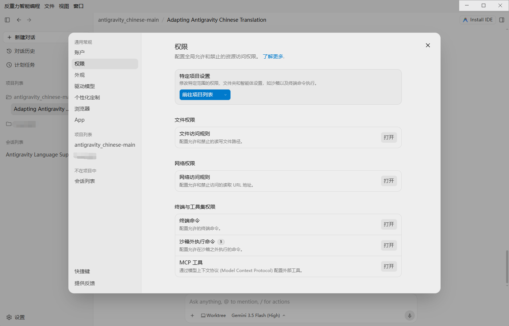

# Antigravity 2.0 智能编程中文语言包 & 汉化引擎

👉 **[繁體中文版說明文件 (Traditional Chinese README)](README_TW.md)**

> **支持系统**：Windows & macOS (均已内置一键脚本)  
> **匹配版本**：Antigravity v2.33.0+  

> **核心引擎**：Node.js (无需安装 Python，零依赖，极速极稳)  
> **汉化范围**：包括软件界面、鼠标悬浮提示 (Tooltip)、Sidecar 伴生面板（含 Swarm 面板与 `plugin://` 子框架）、顶部系统菜单、任务栏与原生系统右键菜单 (Context Menu)、主进程原生弹窗（退出确认、WSL/SSH 提示、设备与 Passkey 选择等）、更新弹窗、加载动画、设置面板、插件与自定义项、新手引导及登录页。  
> **注入原理**：通过纯 Node.js 原生解析并校验重包 `app.asar`，安全注入前端 `preload.js` 动态隔离引擎与主进程补丁，绝不修改核心二进制，一键安装与无损还原。

## 📸 汉化效果展示

以下是部分功能板块的实际汉化效果展示，涵盖登录引导页、主编辑器界面与详细设置面板：

### 1. 欢迎页与登录新手引导


### 2. 主编辑器界面与菜单


### 3. 详细参数设置面板


---

## 📂 项目文件结构
- **`双击安装中文汉化.bat`** / **`.command`**：Windows / macOS 一键简体汉化执行入口（另有对应繁体中文版脚本）。
- **`双击卸载还原官方英文.bat`** / **`.command`**：Windows / macOS 一键完美恢复原版入口。
- **`localization_engine.js`**：核心汉化调度引擎，负责环境探测、进程锁释放、词典编译、缓存清理及 macOS `Info.plist` 校验与自动重签名。
- **`src/`**：模块化核心源码：
  - `preload_runtime.js`：前端 DOM 动态隔离与表驱动正则引擎（含内容隔离、Shadow DOM 穿透与原生右键菜单钩子）。
  - `main_patches.js`：主进程补丁集（`preload.js`、`utils.js` Sidecar 注入、`menu.js`、`tray.js`、`loadingOverlay.js`、`updater.js` 及 `main.js` 等原生弹窗模块）。
  - `asar_patcher.js`：零依赖纯 Node.js 二进制 ASAR 读取、补丁写入与候选包完整性校验器。
- **`dicts/`** / **`dicts_tw/`**：简繁双语对照词典文件夹（各 6 个分模块 JSON 文件）。
- **`scripts/`**：工程与自动化工具集，包含简繁词典对齐与禁用词校验器 (`compare_dicts.js`)、版本升级全量界面/悬浮/模板文案自动 Diff 扫描器 (`dev_tool.js scan-ui`) 及 MCP 基准清册 (`dev_tool.js dump-mcp`)。
- **`tests/`**：基于 Node 原生 test runner 与 `jsdom` 的自动化回归测试套件。

---

## 🚀 极速使用指南

### 1. 获取汉化包代码（二选一）

* **方法 A：直接下载 ZIP 压缩包（最便捷 📦）**
  1. 点击页面右上角绿色的 **`Code`** 按钮。
  2. 在下拉菜单中选择 **`Download ZIP`** 并下载。
  3. 将下载好的压缩包**解压到您电脑本地的任意目录**（例如您的 `Downloads` 文件夹）。

* **方法 B：通过 Git 命令行克隆（开发者推荐 💻）**
  如果您本地安装了 Git，可以直接在终端运行克隆命令：
  ```bash
  # 如果您在国内且镜像可用，可通过代理加速克隆（如镜像失效请更换其他可用代理）：
  git clone https://mirror.ghproxy.com/https://github.com/qqxpee/antigravity2-cn.git
  
  # 如果您配置了全局代理，可直接使用官方地址：
  git clone https://github.com/qqxpee/antigravity2-cn.git
  ```

---

### 2. 一键安装汉化
1. **完全退出** Antigravity 编程软件。
2. 进入您解压或克隆出来的 `antigravity2-cn` 文件夹：
   - **Windows**：双击运行 **`双击安装中文汉化.bat`**。
   - **macOS**：双击运行 **`双击安装中文汉化.command`**。
3. 按提示选择左上角品牌显示方式：
   - **显示英文 Antigravity（默认推荐）**：保留官方品牌名，避免左上角显示过长。
   - **不显示品牌名**：隐藏左上角的品牌文字。
   - **显示中文品牌名**：保持原汉化效果，显示“反重力智能编程”。
4. 运行完成后，重新启动 Antigravity 软件，即可畅享全中文界面！

### 品牌显示命令行参数

如果您通过命令行运行 `localization_engine.js`，可使用 `--brand-title` 控制左上角品牌名：

```bash
# 默认推荐：左上角显示 Antigravity
node localization_engine.js --brand-title english

# 隐藏左上角品牌名
node localization_engine.js --brand-title hidden

# 显示中文品牌名
node localization_engine.js --brand-title translated
```

---

### 3. 一键卸载还原
1. **完全退出** Antigravity 编程软件。
2. 在当前文件夹下：
   - **Windows**：双击运行 **`双击卸载还原官方英文.bat`**。
   - **macOS**：双击运行 **`双击卸载还原官方英文.command`**。
3. 运行完成后，软件将自动清除所有汉化注入，无痕恢复至官方原版英文状态。

---

## 🔌 可选高级功能：网络透明代理自动注入 (Windows 免 TUN 方案)

如果您处于网络受限环境（例如连通 Google AI / Gemini 接口受阻），且不希望开启系统的全局虚拟网卡/TUN 模式，本项目支持在安装汉化时**自动联动注入 Windows 免 TUN 强制代理工具**。

该方案基于优秀的开源项目 **[yuaotian/antigravity-proxy](https://github.com/yuaotian/antigravity-proxy)**（基于 MinHook 的 DLL 劫持透明代理）。

### 使用方法：
1. 前往 **[yuaotian/antigravity-proxy](https://github.com/yuaotian/antigravity-proxy)** 获取编译好的文件：
   - `version.dll`
   - `dbghelp.dll`
   - `config.json`
2. 在当前汉化项目根目录新建 `proxy_config` 文件夹（该文件夹已加入 `.gitignore` 本地排除，绝不会被 Git 提交污染）。
3. 将 `version.dll`、`dbghelp.dll` 以及按您本地代理端口（如 `127.0.0.1:7890` / `18080`）配置好的 `config.json` 放入 `proxy_config/` 目录。
4. 正常双击运行 **`双击安装中文汉化.bat`**：
   - 汉化引擎将**自动检测** `proxy_config/` 目录。
   - 一步自动完成 **“界面中文汉化 + 代理模块注入与同步更新”**，若有代理配置变动会自动覆盖更新，无需再在软件更新后每次手动拷贝 DLL 文件！
5. **完全可选 & 零侵入**：
   - 如果您不需要代理或未创建 `proxy_config/` 目录，安装流程保持 100% 官方纯净汉化，对普通用户零干扰。
   - 运行 **`双击卸载还原官方英文.bat`** 时还原官方汉化，并保留已注入的代理文件（避免误删外部代理或影响英文环境下的网络连接；如需移除代理可手动删除对应文件）。

---

## 🛠️ 汉化原理说明

本引擎采用 **零依赖原生 ASAR 校验重包模式**，专为 **Antigravity 2.0+** 的 Electron 架构量身定制：
1. **自动释放锁与多级缓存清理**：脚本运行前会自动探测并安全关闭 Antigravity 进程；注入完成后自动递归清理 `Antigravity` / `Antigravity IDE` 顶层及 `Partitions/hub-browser-*` 等分区下的 `Cache`、`Code Cache`、`GPUCache` 字节码缓存。
2. **安全备份与事务保护**：首次运行时在软件目录创建原始 `app.asar.bak` 备份；构建候选包并逐文件通过 `node --check` 与完整性校验后才原子替换，支持随时无损还原。
3. **精准注入**：
   - `preload.js`：采用 `WeakMap` / `WeakSet` 与 Shadow DOM 穿透，启动微任务合批的 `MutationObserver` 引擎，在严格隔离代码编辑器、终端与消息正文的前提下动态汉化 UI，并拦截原生右键菜单 IPC。
   - `utils.js`：在主窗口加载并校验目标来源后，向 Sidecar 伴生面板子框架（`http(s)://` 与 `plugin://`）注入动态汉化运行时。
   - `menu.js` / `tray.js` / `updater.js` / `loadingOverlay.js`：汉化系统级标题栏菜单、托盘菜单、更新检查弹窗以及启动加载页（`正在加载 Antigravity…`）。
   - 主进程原生弹窗与内置页（`main.js`、`ipcHandlers.js`、`remoteManager.js`、`sshPrompts.js`、`deviceChooser.js`、`webauthn.js`、`webviewPopupSecurity.js`、`provisionSplash.js`）：覆盖退出确认框、macOS Dock 菜单、WSL 初始化与报错、SSH 安全密钥提示、设备/Passkey 选择与弹窗连接安全信息。

---

## 💡 如何通过 AI 助手自动补充或修改汉化？

如果在使用过程中，您发现了漏译的英文，或者觉得某些中文翻译不够接地气，**您可以直接在聊天窗口中命令您的 AI 编码助手（即 Antigravity）来帮您更新词库**！无论是直接发截图还是描述文字，AI 都会自动帮您把对照词条写进词典。

> [!IMPORTANT]
> **⚠️ AI 助手如何定位您的汉化词库文件？**
> 
> 1. **推荐做法（最省心）**：
>    在 Antigravity 软件中，点击 **“打开文件夹 (Open Folder)”**，直接将本汉化包目录（即包含当前 `README.md` 的文件夹）作为**项目/工作区**打开，然后在此工作区下与 AI 对话。此时 AI 能够直接感知并读写当前项目，您不需要提供任何路径，直接发送翻译要求，AI 就能在后台自动帮您改好词典！
> 
> 2. **免开项目做法（提示词中需指定汉化目录）**：
>    如果您当前正在开发别的项目，没有把汉化目录作为项目打开，那么您在对 AI 发起汉化命令时，**必须在提示词里明确告诉 AI 您的汉化包所在路径**，否则 AI 无法得知要修改您电脑上的哪个文件夹。
>    * **提示词示例**：
>      > **“我的汉化包目录在 `C:\Users\您的电脑用户名\Downloads\antigravity2-cn`（请替换为您本地的实际路径），请帮我把下面这张截图里漏译的内容补全到词典里。”**

### 📋 常用提示词（Prompt）模板

#### 1. 方式一：直接在聊天中发送截图（推荐 📸）
如果您不方便打字，可以直接将未汉化干净的界面截图粘贴发送给 AI，并附带以下指令：
> **“帮我把这张截图里所有未汉化的英文选项和面板内容补全到中文词典中。”**
*(AI 会自动通过视觉识别截图中的全部英文，并精准写入字典。)*

#### 2. 方式二：直接在聊天中发送文字描述（极速 ✍️）
如果您只想修改或增加某一个特定词汇，可以直接发送文字描述给 AI：
> **“帮我把漏译的英文 'Allow agent to view and edit files outside of the current workspace automatically' 汉化为 '允许智能体自动查看并编辑当前工作区之外的文件'。”**
*(AI 会立即找到对应的词典并精准修改或追加该词条。)*

---

### 🔄 更新生效流程
1. **命令 AI 更新**：在对话中通过截图或文字告诉 AI 您的汉化需求，AI 会自动更新 `dicts/` 下的字典文件。
2. **退出软件**：**完全退出**您的 Antigravity 软件。
3. **重新注入**：在当前文件夹中**再次双击运行 `双击安装中文汉化.bat` / `.command`** 重新部署汉化。
4. **重启软件**：重新打开 Antigravity，您的改动即可完美生效！

---

## 🧩 版本升级差异扫描与 MCP 清单自动对齐 (欢迎社区共建)

Antigravity 2.x 的前端 SPA 与“**添加 MCP 服务器 (Add MCP Server)**”市场目录均由客户端内置 `language_server` 与云端 RPC 动态提供。版本升级时无需手动逐页截图，项目已内置直连客户端的自动化扫描工具 [`scripts/dev_tool.js`](scripts/dev_tool.js)：

### 📌 极简同步流程（AI 助手 / 开发者适用 💻）
1. 先启动并打开最新版 Antigravity 客户端（确保后台 `language_server` 进程正在运行）。
2. 在项目根目录执行以下命令扫描版本升级差异：
   ```bash
   # 1. 扫描全量界面、悬浮提示与模板字面量文案差异（结果输出至 scratch/untranslated_ui_diff.json）
   node scripts/dev_tool.js scan-ui

   # 2. 拉取最新官方 MCP 目录并与基准清册对比（发现变更时输出至 scratch/mcp_catalog_diff.json）
   node scripts/dev_tool.js dump-mcp
   ```
3. 将生成的 `scratch/` 增量文件交给 AI 助手，按规范补充翻译至 `dicts/` 与 `dicts_tw/`（或调整 `src/preload_runtime.js` 动态规则）。
4. 运行校验并更新基准：
   ```bash
   node scripts/compare_dicts.js
   node scripts/dev_tool.js scan-ui --update-baseline
   node scripts/dev_tool.js dump-mcp --update-baseline
   ```
5. 清理 `scratch/` 后重新运行安装脚本即可立即生效；欢迎提交 Pull Request 共同维护！

> 💡 **提示**：更多诊断命令（如 `port`、`search`、`slice`）可直接查看 [`scripts/dev_tool.js`](scripts/dev_tool.js) 顶部的注释说明。

---

## 📝 词典自定义指南 (供极客手动使用)

如果您想手动修改翻译，可以直接打开 `dicts/`（简体）或 `dicts_tw/`（繁体）目录下的 6 个 JSON 文件：
- **`common.json`**：公共基础词汇、侧边栏概览、登录页、常用按钮等。
- **`menu_nav.json`**：系统及菜单栏翻译。
- **`page_main.json`**：主对话区、编辑器、工作区及核心交互文案。
- **`page_agents.json`**：智能体 / 子代理 / Swarm 协作相关文案。
- **`page_settings.json`**：详细设置面板与权限二级菜单对照。
- **`page_mcp_knowledge.json`**：官方 MCP 服务器及知识库说明翻译。

在 JSON 中新增一行，格式如下即可（注意英文逗号）：
```json
"Original English Text": "您的中文翻译"
```
保存后，双击运行 **`双击安装中文汉化.bat` / `.command`** 重新部署汉化即可。

---

## 常见问题解答 (FAQ)

### 1）提示“解包失败”或缺少 npm 环境
* **原因**：汉化引擎依赖 Node.js 进行 ASAR 包的解析。
* **解决**：由于 Antigravity 本身就是一个基于 Node.js/Electron 的程序，您的电脑一般都已自带环境。如果极少数情况下报错，只需在电脑安装 [Node.js](https://nodejs.org/)（LTS 版本即可）并重启脚本。

### 2）提示“权限不足”或 macOS 提示“无法打开”
* **解决**：
  - **Windows**：请右键点击 `双击安装中文汉化.bat`，选择 **“以管理员身份运行”**。
  - **macOS**：若双击运行 `.command` 提示无法打开或没有执行权限，可在终端中执行 `chmod +x *.command` 来授权。如果是系统安全拦截，请在“系统设置 -> 隐私与安全性”中点击“仍要打开”。本汉化包已内置自动重签名机制，修改后会重新进行 Ad-hoc 签名以防止 macOS 提示应用损坏。

### 3）软件官方更新后，汉化失效了怎么办？（含 Windows 自检启动器）
* **原因**：Antigravity 内置 `electron-updater`（`autoDownload = true`、`autoInstallOnAppQuit = true`），后台下载的更新包会在您退出软件时静默安装并覆盖 `resources/app.asar`，因此下次打开会变回英文。
* **手动恢复**：完全退出软件，重新双击运行 **`双击安装中文汉化.bat`**（macOS 用户运行 **`双击安装中文汉化.command`**）即可恢复中文。
* **Windows 自动自检启动**：可双击或创建桌面快捷方式指向 **`启动Antigravity(自动检查汉化).bat`**（底层调用 `node scripts/ensure_localized.js --fix --launch`）。它会在启动前检查 `app.asar` 是否含汉化标记；若已被官方自动更新覆盖且目标客户端未在运行，会自动沿用上次的 `--tw` / `--brand-title` 偏好以 `--no-kill` 重新注入后再拉起客户端（若修复失败会中止启动并报错，不会直接启动英文版；如需显式切换繁体或简体，可在参数中附加 `--tw` 或 `--sc`）。

### 4）在简体中文 Windows 上运行繁体版脚本提示乱码怎么办？
* 为兼容繁体中文 Windows（代码页 `CP950`），`双击安装繁体中文.bat` 按 Big5 编码保存；在简体中文 Windows（默认 `CP936`）直接双击时终端提示会显示乱码。可在 CMD 中先切换代码页再运行：`chcp 950 && 双击安装繁体中文.bat`，或直接执行 `node localization_engine.js --tw --brand-title english`。

---

## 回归测试

测试依赖固定为 jsdom `30.1.3`，需 Node.js `^22.22.2 || ^24.15.0 || >=26.0.0`；建议使用 Node.js 24.15.0 或更新的 24.x 版本。在项目目录运行：

```sh
npm ci
npm test
node --check localization_engine.js
node --check src/preload_runtime.js
node --check src/main_patches.js
node --check src/asar_patcher.js
node --check scripts/ensure_localized.js
node --check scripts/compare_dicts.js
node --check scripts/dev_tool.js
node scripts/compare_dicts.js
```

测试从当前源码生成翻译脚本，在 jsdom 和临时文件夹中验证内容隔离、表单值、Shadow DOM、Swarm/Sidecar 网关、主进程弹窗 ASAR 校验、多级缓存清理及模板动态规则行为，不启动或修改本机 Antigravity。GitHub Actions 会在 Windows 和 Linux 上执行这些检查。

---

## 📈 Star 增长趋势与社区生态 (Star History)

[](https://star-history.com/#qqxpee/antigravity2-cn&Date)

---

## 🤝 致谢
- 感谢所有参与测试与反馈的贡献者！
- 特别鸣谢 **[yuaotian/antigravity-proxy](https://github.com/yuaotian/antigravity-proxy)** 提供优秀的 Windows 免 TUN 强制代理注入方案。
- 特别鸣谢 **[yiheng8023/antigravity-chinese](https://github.com/yiheng8023/antigravity-chinese)** 开放的词典成果（MIT 协议），为本次 v2.26.0+ 新增特性词条整合提供了重要基础。
