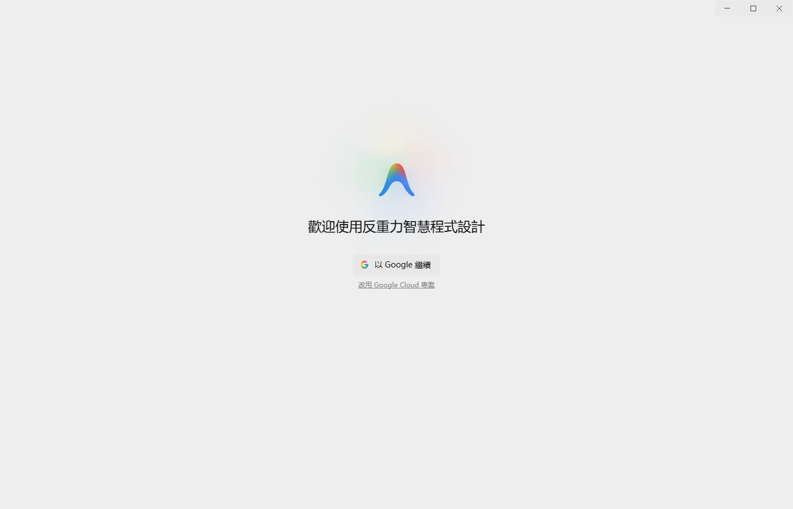
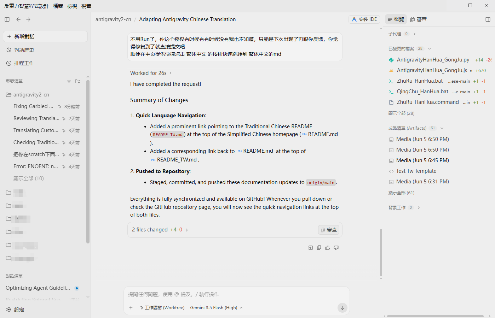
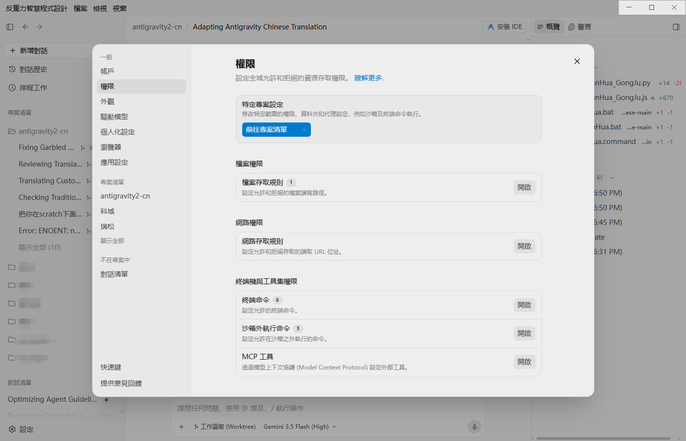

<div align="center">

# Antigravity 2.0 智能編程中文語言套件 & 繁體中文引擎

**零依賴純 Node.js 原生注入 · 獨立維護台灣標準術語 · 一鍵安裝與無損還原**

[](https://antigravity.google/download)
[](#-快速開始)
[](https://github.com/qqxpee/antigravity2-cn/actions/workflows/tests.yml)
[](https://github.com/qqxpee/antigravity2-cn/stargazers)
[](LICENSE)

👉 **[簡體中文版說明文件 (Simplified Chinese README)](README.md)**

[✨ 核心特色](#-核心特色) · [📸 效果預覽](#-效果預覽) · [🚀 快速開始](#-快速開始) · [❓ 常見問題](#-常見問題) · [🔌 進階功能](#-進階功能) · [🛠️ 原理與開發](#️-原理與開發)

</div>

---

## ✨ 核心特色

- **開箱即用，零依賴**：純 Node.js 原生解析並校驗重新封裝 `app.asar`，無需安裝 Python，三端（Windows / macOS / Linux）均內建一鍵指令碼。
- **全量深度在地化**：涵蓋主介面、滑鼠懸浮提示 (Tooltip)、Sidecar 伴生面板（含 Swarm 與 `plugin://` 子框架）、頂部系統選單、系統匣與原生右鍵選單、主處理程序原生彈出視窗（結束確認、WSL/SSH 提示、裝置與 Passkey 選取等）、更新彈出視窗、載入動畫、設定面板及登入導覽頁。
- **獨立維護台灣 `zh-TW` 術語**：非簡體字元直轉，依台灣開發者習慣與 VS Code / Google 台灣產品規範逐條審校（如「代理 / 設定 / 檔案 / 權杖 / 檢視」），並設自動化門禁防止非台灣用語迴流。
- **嚴格內容隔離與可逆備份**：透過 `WeakMap` / `WeakSet` 與 Shadow DOM 穿透隔離程式碼編輯器、終端機與訊息正文；首次執行自動備份 `app.asar.bak`，隨時支援一鍵無損還原官方英文。

---

## 📸 效果預覽

> [!NOTE]
> 以下截圖錄製於專案初期的 **Antigravity v2.0.11**（2026-06），僅供在地化效果與風格參考；目前已持續跟進支援至 **v2.35.1+**，最新版介面與新增面板（如 Swarm、Sidecar、MCP 市場、原生彈出視窗等）皆已覆蓋。

<details>
<summary><b>👉 點擊展開早期版本繁體中文化效果截圖（Antigravity v2.0.11 時期）</b></summary>

### 1. 歡迎頁與登入新手引導


### 2. 主編輯器介面與選單


### 3. 詳細參數設定面板


</details>

---

## 🚀 快速開始

### 第 1 步：取得中文化套件（二選一）

- **方法 A：直接下載 ZIP 壓縮檔（推薦新手 📦）**
  1. 點選本頁右上角綠色的 **`Code`** 按鈕，選擇 **`Download ZIP`**。
  2. 將壓縮檔**解壓縮至本機任意目錄**（例如 `Downloads` 資料夾）。

- **方法 B：透過 Git 複製（方便後續更新 💻）**
  ```bash
  # 若處於受限網路環境且鏡像可用，可透過代理加速複製（如鏡像失效請更換其他可用代理）：
  git clone https://mirror.ghproxy.com/https://github.com/qqxpee/antigravity2-cn.git

  # 或直接使用官方位址（需本機代理）：
  git clone https://github.com/qqxpee/antigravity2-cn.git
  ```

### 第 2 步：一鍵安裝繁體中文

1. **完全結束** Antigravity 軟體（確保背景進程已關閉）。
2. 進入解壓縮或複製後的 `antigravity2-cn` 資料夾，依系統執行對應指令碼：

| 系統平台 | 一鍵安裝（繁體中文） | 一鍵解除安裝（還原英文） |
| :--- | :--- | :--- |
| **Windows** | 按兩下 **`双击安装繁体中文.bat`** | 按兩下 **`双击卸载还原官方英文.bat`** |
| **macOS** | 按兩下 **`双击安装繁体中文.command`** | 按兩下 **`双击卸载还原官方英文.command`** |
| **Linux** | 終端機執行 **`./install_linux.sh --tw`** | 終端機執行 **`./uninstall_linux.sh --tw`** |

> [!TIP]
> Linux 若目標安裝目錄（如 `/opt/antigravity`）需要管理員權限，指令碼會自動透過 `sudo` 提權並正確清除目前使用者的 Electron 快取。

3. 依提示選擇左上角品牌顯示方式：顯示英文 `Antigravity`（預設推薦）、不顯示品牌名稱，或顯示繁體中文品牌名。
4. 執行完成後重新啟動 Antigravity 即可生效。

> [!TIP]
> **Windows 防自動更新失效小技巧**：Antigravity 官方在結束程式時可能會於背景靜默更新並覆寫回英文。建議可執行 `node scripts/ensure_localized.js --fix --launch --tw`（或於 **`启动Antigravity(自动检查汉化).bat`** 內加上 `--tw`）作為啟動捷徑，每次啟動前會自動檢查並在需要時補回繁體中文。

<details>
<summary><b>⚙️ 命令列參數參考（<code>--tw</code> 與 <code>--brand-title</code>）</b></summary>

如果您透過命令列直接執行 `localization_engine.js`，可使用 `--brand-title` 控制左上角品牌名：

```bash
# 預設推薦：左上角顯示 Antigravity
node localization_engine.js --tw --brand-title english

# 隱藏左上角品牌名
node localization_engine.js --tw --brand-title hidden

# 顯示繁體中文品牌名
node localization_engine.js --tw --brand-title translated
```

</details>

---

## ❓ 常見問題

<details>
<summary><b>1. 提示「解包失敗」或缺少 Node.js / npm 環境怎麼辦？</b></summary>

- **原因**：中文化引擎依賴 Node.js 進行 ASAR 封裝解析。由於 Antigravity 本身基於 Node.js / Electron，多數情況下指令碼會自動復用環境。
- **解決**：若極少數情況仍回報錯誤，請安裝 [Node.js](https://nodejs.org/)（LTS 版本即可），安裝後重新執行指令碼。

</details>

<details>
<summary><b>2. Windows 提示「權限不足」，或 macOS 提示「無法開啟」 / <code>EPERM</code> 怎麼辦？</b></summary>

- **Windows**：對 `双击安装繁体中文.bat` 按右鍵，選擇 **「以系統管理員身分執行」**。
- **macOS 提示無權限 / 已損壞**：
  - 於終端機執行 `chmod +x *.command` 授予執行權限；若被系統安全攔截，請在 **「系統設定 -> 隱私權與安全性」** 中按一下 **「仍要開啟」**。
  - 本套件已內建自動 Ad-hoc 重新簽名機制，正常完成注入後不會提示應用程式損壞。
- **macOS 輸入密碼後仍提示「目標目錄不可寫入」或 `EPERM`**：
  - 從 macOS 13 (Ventura) 起，修改 `/Applications` 中的應用程式會受系統「App 管理」（TCC）攔截，僅靠 `sudo` 無法繞過。
  - 請前往 **「系統設定 -> 隱私權與安全性 -> App 管理」**，為您目前執行指令碼的終端機應用程式（如「終端機 / Terminal」、iTerm2、Warp、VS Code 內建終端機等，清單若無可按 `+` 手動新增）開啟權限；若仍失敗，再為同一終端機開啟 **「完全磁碟存取權限」**。
  - 授權後請按 `Cmd+Q` **完全結束該終端機**並重新開啟，再執行指令碼（此權限依「發起操作的終端機應用程式」個別授權，改用其他終端機時需重新授權）。

</details>

<details>
<summary><b>3. 為什麼 Windows 更新後變回英文？macOS 如何升級新版？</b></summary>

- **平台機制差異**：
  - **Windows**：Antigravity 內建 `electron-updater`（NSIS，`autoDownload = true`、`autoInstallOnAppQuit = true`），結束軟體時會在背景靜默安裝並覆寫 `resources/app.asar`，導致下次開啟變回英文。
  - **macOS**：中文化後應用程式套件採用本機 ad-hoc 重新簽名（`codesign --sign -`），designated requirement 僅符合目前套件自身的 `cdhash`。內建自動更新（`Squirrel.framework`）在驗證階段會攔截覆寫（`did not pass validation`），因此不會「更新後變回英文」，而是停留在舊版。
- **Windows 恢復方式**：
  - **手動恢復**：完全結束軟體，重新按兩下 **`双击安装繁体中文.bat`**。
  - **自動自檢啟動**：使用 `node scripts/ensure_localized.js --fix --launch --tw`（或於 **`启动Antigravity(自动检查汉化).bat`** 內加上 `--tw`）啟動軟體。啟動前會自動檢查 `app.asar` 是否含中文化標記；若已被官方更新覆寫且用戶端未執行，會沿用上次的 `--tw` / `--brand-title` 偏好以 `--no-kill` 重新注入後再拉起用戶端（若修復失敗會中止啟動並回報錯誤，不會直接啟動英文版；如需切換簡體可傳入 `--sc`）。
- **macOS 升級方式**：前往 [antigravity.google/download](https://antigravity.google/download) 下載最新版 DMG 覆寫安裝 `Antigravity.app`，再重新按兩下 **`双击安装繁体中文.command`** 即可。

</details>

<details>
<summary><b>4. 在簡體中文 Windows 上執行繁體版指令碼提示亂碼怎麼辦？</b></summary>

- 為相容繁體中文 Windows（字碼頁 `CP950`），`双击安装繁体中文.bat` 依 Big5 編碼儲存；在簡體中文 Windows（預設 `CP936`）直接按兩下時終端機提示會顯示亂碼。
- 可在 CMD 中先切換字碼頁再執行：`chcp 950 && 双击安装繁体中文.bat`，或直接執行 `node localization_engine.js --tw --brand-title english`。

</details>

---

## 🔌 進階功能

### 1. 網路透明代理自動注入（Windows 免 TUN 方案）

如果您處於網路受限環境（例如連線 Google AI / Gemini API 遇到限制），且不想開啟系統虛擬網卡 / 全域 TUN 模式，本專案支援在安裝中文化時**自動聯動注入 Windows 免 TUN 強制代理工具**（基於開源專案 **[yuaotian/antigravity-proxy](https://github.com/yuaotian/antigravity-proxy)**）。

1. 前往 **[yuaotian/antigravity-proxy](https://github.com/yuaotian/antigravity-proxy)** 下載最新編譯好的代理檔案（通常包含 `.dll` 劫持模組如 `version.dll` 等，以及設定範本 `config.json`，具體檔名以該版本發布說明為準）。
2. 在目前中文化專案根目錄新增 `proxy_config` 資料夾（已設定 `.gitignore` 本機排除，絕不會被 Git 提交）。
3. 將所需的全部代理檔案（對應的 `.dll` 檔案，以及依本機代理連接埠如 `127.0.0.1:7890` / `18080` 編輯好的 `config.json`）放入 `proxy_config/` 目錄。
   > [!WARNING]
   > 引擎會將 `proxy_config/` 下的**所有檔案**同步複製到軟體安裝目錄，請勿在此資料夾中放置無關檔案或壓縮檔。
4. 正常按兩下執行 **`双击安装繁体中文.bat`**：引擎將自動偵測 `proxy_config/`，一步完成「繁體中文化 + 代理模組注入/覆寫更新」，軟體更新後也無需每次手動複製 DLL。
5. **零破壞設計**：未建立 `proxy_config/` 時維持 100% 純淨中文化；執行 **`双击卸载还原官方英文.bat`** 時僅還原官方英文，並保留已注入的代理檔案（如需移除可手動刪除）。

---

### 2. 自訂與補充翻譯

發現漏譯或想微調特定詞條時，可以直接讓 Antigravity 裡的 AI 幫您改，也可以手動編輯 JSON 詞典：

#### 方式 A：透過 AI 助手自動補充/修改（推薦 🤖）

> [!IMPORTANT]
> **如何讓 AI 定位您的詞庫目錄？**
> 1. **最省心**：在 Antigravity 中按一下 **「開啟資料夾 (Open Folder)」** 直接開啟本 `antigravity2-cn` 目錄，在此工作區下直接傳圖或提出需求，AI 會自動定位並修改詞典。
> 2. **免開專案**：若正在其他專案工作區對話，請在提示詞中明確寫出中文化套件實際路徑，例如：
>    `「我的中文化包目錄在 C:\Users\您的使用者名稱\Downloads\antigravity2-cn，請幫我把截圖裡漏譯的內容補全到繁體詞典。」`

- **截圖補全**：直接貼上傳送未中文化介面的截圖並附帶指令：
  > **「幫我把這張截圖裡所有未中文化的英文選項和面板內容補全到繁體中文詞典中。」**
- **精確修改**：直接傳送文字描述：
  > **「幫我把漏譯的英文 'Allow agent to view and edit files outside of the current workspace automatically' 翻譯為 '允許代理自動檢視並編輯目前工作區之外的檔案'。」**

#### 方式 B：手動編輯詞典 JSON（極客向 📝）

直接編輯 `dicts/`（簡體）或 `dicts_tw/`（繁體）下的 6 個分模組 JSON 檔案（注意結尾英文逗號）：
- **`common.json`**：公共基礎詞彙、側邊欄概覽、登入頁、常用按鈕等
- **`menu_nav.json`**：系統及選單列翻譯
- **`page_main.json`**：主對話區、編輯器、工作區及核心互動文字
- **`page_agents.json`**：代理 / 子代理 / Swarm 協作相關文字
- **`page_settings.json`**：詳細設定面板與權限二級選單對照
- **`page_mcp_knowledge.json`**：官方 MCP 伺服器及知識庫說明翻譯

```json
"Original English Text": "您的繁體中文翻譯"
```

> 儲存後，**完全結束 Antigravity** 並重新執行 **`双击安装繁体中文.bat` / `.command`**（或 `./install_linux.sh --tw`）即可生效。

---

## 🛠️ 原理與開發

### 1. 中文化原理與專案結構

本引擎採用 **零依賴原生 ASAR 校驗重包模式**，專為 **Antigravity 2.0+** 的 Electron 架構設計：

<details>
<summary><b>🔍 點擊展開注入原理與原始碼目錄詳情</b></summary>

#### 注入與安全機制
1. **自動釋放鎖與多級快取清除**：執行前自動偵測並安全關閉 Antigravity 進程；注入完成後遞迴清除 `Antigravity` / `Antigravity IDE` 頂層及 `Partitions/hub-browser-*` 等分區下的 `Cache`、`Code Cache`、`GPUCache` 位元組碼快取。
2. **安全備份與交易保護**：首次執行建立原始 `app.asar.bak` 備份；建置候選封裝並逐檔通過 `node --check` 與完整性校驗後才原子替換，支援隨時無損還原。
3. **精準注入點**：
   - `preload.js`：採用 `WeakMap` / `WeakSet` 與 Shadow DOM 穿透，啟動微任務合批的 `MutationObserver` 引擎，在嚴格隔離程式碼編輯器、終端機與訊息正文的前提下動態中文化介面，並攔截原生右鍵選單 IPC。
   - `utils.js`：在主視窗載入並校驗目標來源後，向 Sidecar 伴生面板子框架（`http(s)://` 與 `plugin://`）注入動態中文化執行時。
   - `menu.js` / `tray.js` / `updater.js` / `loadingOverlay.js`：中文化系統級標題列選單、系統匣選單、更新檢查彈出視窗以及啟動載入頁（`正在載入 Antigravity…`）。
   - 主處理程序原生彈出視窗與內建頁面（`main.js`、`ipcHandlers.js`、`remoteManager.js`、`sshPrompts.js`、`deviceChooser.js`、`webauthn.js`、`webviewPopupSecurity.js`、`provisionSplash.js`）：涵蓋結束確認視窗、macOS Dock 選單、WSL 初始化與錯誤提示、SSH 安全金鑰提示、裝置/Passkey 選取與彈出視窗連線安全資訊。

#### 專案檔案結構
- **`双击安装繁体中文.bat` / `.command` / `install_linux.sh`**：三端一鍵繁體安裝入口（Windows/macOS 另有簡體版，Linux 可加 `--tw`）。
- **`双击卸载还原官方英文.bat` / `.command` / `uninstall_linux.sh`**：三端一鍵還原原版入口。
- **`启动Antigravity(自动检查汉化).bat`**：Windows 自檢啟動器（加上 `--tw` 可用於繁體），自動偵測並修復被官方更新覆寫的中文化。
- **`localization_engine.js`**：核心排程引擎（環境偵測、進程釋放、詞典編譯、快取清除、macOS `Info.plist` 校驗與自動重新簽名）。
- **`src/`**：模組化核心原始碼
  - `preload_runtime.js`：前端 DOM 動態隔離與表驅動正規表達式引擎（含內容隔離、Shadow DOM 穿透與原生右鍵選單掛鉤）。
  - `main_patches.js`：主處理程序補丁集（`preload.js`、`utils.js`、`menu.js`、`tray.js`、`loadingOverlay.js`、`updater.js` 及原生彈出視窗模組）。
  - `asar_patcher.js`：零依賴純 Node.js 二進位 ASAR 讀取、補丁寫入與完整性校驗器。
- **`dicts/` / `dicts_tw/`**：簡繁雙語對照詞典（各 6 個 JSON 模組）。
- **`scripts/`**：工程工具集（`compare_dicts.js` 簡繁對齊與禁用詞校驗、`dev_tool.js` 版本升級介面/MCP 掃描、`ensure_localized.js` 自檢啟動）。
- **`tests/`**：基於 Node 原生 test runner 與 `jsdom` 的自動化回歸測試套件。

</details>

### 2. 🇹🇼 繁體中文（台灣 `zh-TW`）在地化與術語校訂方案

本專案的繁體中文支援並非字元直轉，而是採取**獨立維護 + 台灣開發者標準術語校訂 + 自動化門禁校驗**：

<details>
<summary><b>📖 點擊展開台灣標準術語對照表與品質門禁說明</b></summary>

1. **術語對齊基準**：對齊 Microsoft / Visual Studio Code 繁體中文（台灣）語言套件、Google 台灣產品在地化規範及 macOS 系統介面慣用語，並結合開源台灣術語庫（如 `rajatim/zhtw` 與 `OpenCC` 台灣慣用詞表）及英文原鍵逐條審校。

| 英文概念 | 台灣繁體 (`dicts_tw/`) | 嚴禁誤用之非台灣詞彙 |
| :--- | :--- | :--- |
| Agent / Subagent | **代理** / **子代理** | ❌ 智能體 / 子智能體 |
| Settings / Config / Preferences | **設定** / **設定檔** / **偏好設定** | ❌ 設置 / 配置 / 配置文件 |
| Access / Permissions / Policy / Identity | **存取** / **權限** / **原則** / **身分** | ❌ 訪問 / 許可權 / 身份 |
| Save / Archive / Pin / Uninstall | **儲存** / **封存** / **釘選** / **解除安裝** | ❌ 保存 / 歸檔 / 置頂 / 卸載 |
| Send / Get / Sign in / Quit | **傳送** / **取得** / **登入** / **結束** | ❌ 發送 / 獲取 / 登錄 |
| View / Layout / Scroll / Drag / Click | **檢視** / **版面配置** / **捲動** / **拖曳** / **按一下** | ❌ 視圖 / 佈局 / 滾動 / 拖拽 |
| Undo / Reset / Disable / Replace | **復原** / **重設** / **停用** / **取代** | ❌ 撤銷 / 重置 / 禁用 / 替換 |
| Artifact / Repository / Workflow / Sandbox | **成品** / **程式碼存放庫** / **工作流程** / **沙箱** | ❌ 產物 / 交付件 / 倉庫 / 工作流 / 沙盒 |
| Audio / Video / Function / Token / Tab | **音訊** / **影片** / **函式** / **權杖** / **分頁** | ❌ 音頻 / 視頻 / 函數 / 令牌 / 標籤頁 / 選項卡 |
| Quotes / Menu / Instance / Popup | **「」** / **選單** / **執行個體** / **彈出視窗** | ❌ “” / 菜單 / 實例 / 彈窗 |

2. **語意與脈絡區分**：依英文原文區分多義詞，例如 `file` 譯為「**檔案**」、`document` 譯為「**文件**」；`Undo` 譯為「**復原**」、憑證 `revoked` 維持「**撤銷**」；`Unload/Unmount` 譯為「**卸載**」、`Uninstall` 譯為「**解除安裝**」。前端動態規則（[`src/preload_runtime.js`](src/preload_runtime.js)）與主處理程序補丁（[`src/main_patches.js`](src/main_patches.js)）均透過 `--tw` 旗標同步套用相同的台灣術語規範。
3. **自動化品質門禁**：[`scripts/compare_dicts.js`](scripts/compare_dicts.js) 強制檢查簡繁詞典鍵值 **100% 對齊**，並掃描 `dicts_tw/` **零容忍**簡體字殘留、港式異體字（`啓`/`爲` 等）與非台灣慣用詞。繁體相關資源與參數統一以 **`tw` / `TW`** 為識別尾碼（`dicts_tw/`、`README_TW.md`、`showimg/*_tw.png`、`--tw`）。

</details>

### 3. 版本升級差異掃描與 MCP 自動對齊（歡迎社群共建）

Antigravity 2.x 的前端 SPA 與「新增 MCP 伺服器 (Add MCP Server)」目錄由用戶端內建 `language_server` 與雲端 RPC 動態提供。版本升級時無需逐頁截圖，可使用內建 [`scripts/dev_tool.js`](scripts/dev_tool.js) 自動提取差異：

1. 啟動最新版 Antigravity 用戶端（確保背景 `language_server` 進程正在執行）。
2. 在專案根目錄掃描差異並更新翻譯：
   ```bash
   # 1. 掃描全量介面、懸浮提示與範本文字差異 -> scratch/untranslated_ui_diff.json
   node scripts/dev_tool.js scan-ui

   # 2. 對比官方 MCP 目錄變更 -> scratch/mcp_catalog_diff.json
   node scripts/dev_tool.js dump-mcp
   ```
3. 將 `scratch/` 增量檔案交由 AI 助手或手動補充至 `dicts/` 與 `dicts_tw/`（必要時調整 `src/preload_runtime.js` 動態規則）。
4. 執行校驗並更新基準，清除 `scratch/` 後即可測試並提交 PR：
   ```bash
   node scripts/compare_dicts.js
   node scripts/dev_tool.js scan-ui --update-baseline
   node scripts/dev_tool.js dump-mcp --update-baseline
   ```

> [!TIP]
> 更多診斷指令（如 `port`、`search`、`slice`）可直接查閱 [`scripts/dev_tool.js`](scripts/dev_tool.js) 頂部註解。

### 4. 回歸測試

測試依賴固定為 jsdom `30.1.3`，需 Node.js `^22.22.2 || ^24.15.0 || >=26.0.0`（建議使用 Node.js 24.15.0+）。在專案根目錄執行：

```sh
npm ci
npm test
node --check localization_engine.js
node --check src/preload_runtime.js
node --check src/main_patches.js
node --check src/asar_patcher.js
node --check scripts/ensure_localized.js
node --check scripts/compare_dicts.js
node --check scripts/dev_tool.js
node scripts/compare_dicts.js
```

測試從目前原始碼產生翻譯指令碼，在 `jsdom` 與暫存資料夾中驗證內容隔離、表單值、Shadow DOM、Swarm/Sidecar 閘道、主處理程序彈出視窗 ASAR 校驗、多級快取清除及範本動態規則，不啟動或修改本機 Antigravity；GitHub Actions 會在 Windows 和 Linux 上自動執行上述檢查。

---

## 📈 Star 增長趨勢

[](https://star-history.com/#qqxpee/antigravity2-cn&Date)

---

## 🤝 致謝

- 感謝所有參與測試與回饋的貢獻者！
- 特別鳴謝 **[yuaotian/antigravity-proxy](https://github.com/yuaotian/antigravity-proxy)** 提供優秀的 Windows 免 TUN 強制代理注入方案。
- 特別鳴謝 **[yiheng8023/antigravity-chinese](https://github.com/yiheng8023/antigravity-chinese)** 開放的詞典成果（MIT 授權條款），為本專案 v2.26.0+ 新增特性詞條整合提供了重要基礎。

---

## 📄 授權條款

本專案採用 [MIT 授權條款](LICENSE) 開源。
